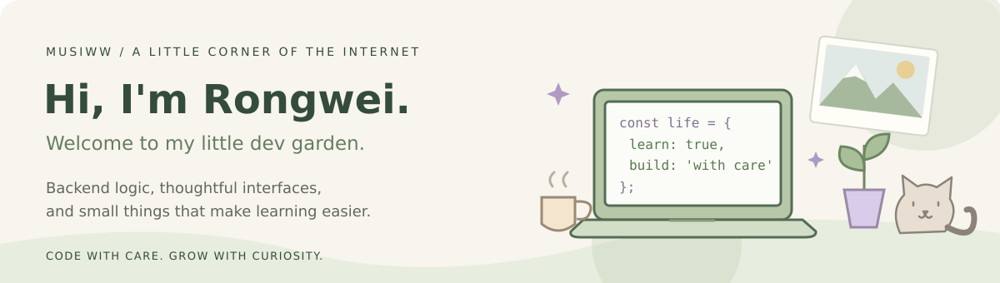

  <b>Rongwei (Vicky) · Software Engineer</b> 
  M.S. in Computer Science, Northwestern University '26  
  <a href="https://rongweiww.com">Portfolio ↗</a>

### 🪻 A little about me

My head is always full of little “what ifs.”✨ What keeps me learning and building is the chance to turn those ideas into something real, something useful, playful, or capable of making someone's day a little better.🥰

My focus is **Java backend and full-stack development**, with a soft spot for **education technology and language learning**. I enjoy connecting the pieces, from backend logic to the little details on screen, and learning whatever an idea needs along the way.

### 🪴 Things I've helped grow

| Project | What I worked on | Tools |
| :--- | :--- | :--- |
| **[Mandarin Pronunciation Feedback](https://rongweiww.com/#work)** | Real-time pitch visualization and pronunciation feedback, with a Spring Boot backend and authenticated learning records. | Java · Spring Boot · Next.js · PostgreSQL · Web Audio |
| **[PaySync](https://paysync.zla.app/)** | A team-built expense-sharing app with group invitations, real-time updates, and settlement logic. | React · TypeScript · Go · Firebase |
| **[PixelTailor](https://github.com/Musiww/PixelTailor-AWS_based_Intelligent_Image_Processing_Application)** | An AWS image-management team project where I focused on Rekognition integration and label-based retrieval. Planning an independent extension into a photo album with natural-language search. | Python · AWS Lambda · S3 · Rekognition · MySQL |
| **[Kitten Card Game](https://rongweiww.com/#work)** | Java game logic and reliability, supported by 130+ unit tests, behavior-driven tests, and mutation testing. | Java · JUnit 5 · Cucumber · JaCoCo · PIT |

Project links open a live demo, source code, or the corresponding overview on my portfolio.

### 🧰 My little toolbox

- **Backend & data** — Java · Spring Boot · Python · Go · PostgreSQL · MySQL · Redis
- **Frontend** — TypeScript · React · Next.js · Tailwind CSS
- **Cloud & quality** — AWS · Docker · GitHub Actions · JUnit 5 · Cucumber · PIT

### 🌿 Growing next

- Deepening my backend skills along the way, from databases and caching to the architecture behind these ideas.
- Building learning tools with clear feedback and approachable interfaces.
- Keeping my [portfolio](https://github.com/Musiww/rongweiww-portfolio) and my little collection of ideas growing, and bringing them to life, one small improvement at a time.
- Planning PixelTailor's next chapter: finding photos by describing what you remember about them.
- Exploring a cozy cycle tracker, playful mini-games, and a little companion app to make focus time feel less lonely.

### ☕ Away from the keyboard
- ☕ Usually happy with a flat white, cute little things🐱, and the joy of learning languages🗣️. Native in Mandarin; learning English, Japanese, and a little Spanish.

- 🏔️ Happiest outdoors — snowboarding🏂, skateboarding🛹, running🏃‍♀️, hiking🚶‍♀️, or making my way up a mountain⛰️. Nature gives my busy mind room to breathe.

- 💭 I love philosophy, conversations about life, and hearing how other people see the world, especially older adults with stories to share and children with wonderfully unexpected questions.💖

---

A little curiosity, a little courage, and lots of ww. 🌱

